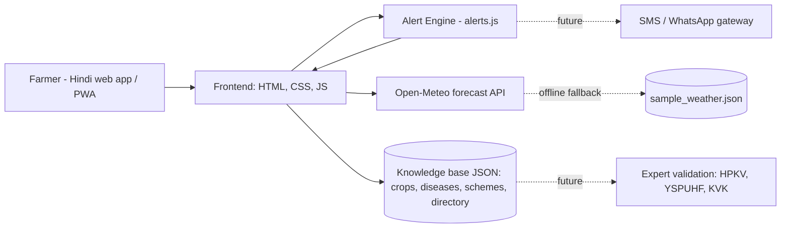
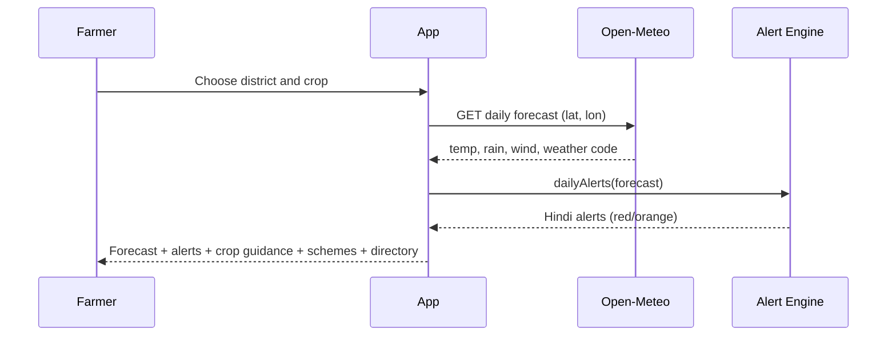

# Technical Design – Kisan Mausam Mitra (Team Eyana)

## 1. Goals
Give hill farmers timely, Hindi, actionable weather-based guidance on low-end phones and weak networks.

## 2. Architecture (prototype = Layer 1-3; SMS = future)

## 3. Data flow

## 4. Components
| Component | File | Purpose |
|---|---|---|
| UI | index.html, app.js | Hindi interface, rendering |
| Alert engine | alerts.js | Threshold rules -> Hindi messages |
| Knowledge base | data/*.json | Crops, diseases, schemes, directory |
| Tests | tests/alerts.test.js | Verifies rules on sample data |

## 5. Alert rules (illustrative; to be tuned with IMD/agri-experts)
- Heavy rain: precipitation >= 30 mm/day (red)
- Hail/storm: weather code 96/99, or 95 with wind >= 30 km/h (red)
- Frost: min temp <= 0 C (orange)
- Strong wind: >= 40 km/h (orange)

## 6. Future design
- Backend (Node/Python) + database for farmer profiles, village location and subscriptions
- Scheduler that runs rules daily and sends SMS/WhatsApp
- Profit planner using validated mandi prices and crop calendars (clearly labelled as estimates)
- PWA offline caching, Hindi text-to-speech for low literacy

## 7. Risks
Data accuracy, forecast uncertainty in mountains, connectivity, adoption -> see presentation (Feasibility and risk).
